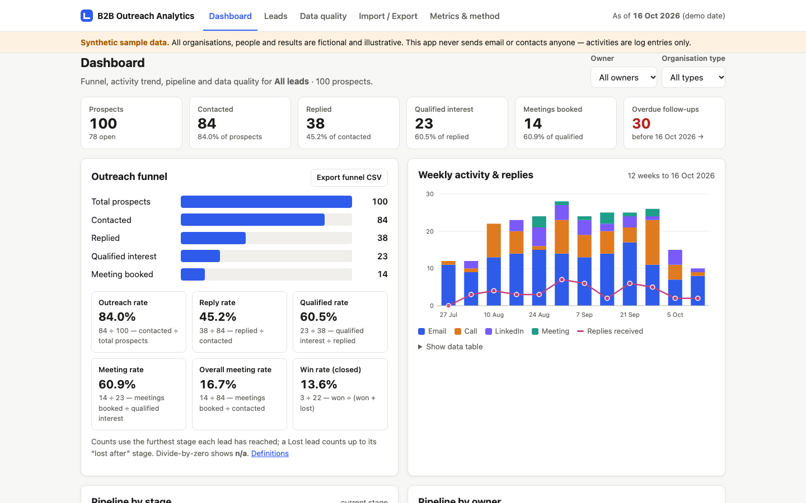

# B2B Outreach Analytics

A working sample CRM and analytics system for **institutional outreach** (universities, schools, hospitals, NGOs, councils): track leads and follow-ups, clean and de-duplicate records, and report funnel metrics with **explicitly defined denominators**.

It runs entirely in the browser: vanilla JavaScript, no build step, no dependencies, no network calls, no accounts.

- **Live demo:** https://dash-boop0.github.io/b2b-outreach-analytics/
- **Source:** https://github.com/Dash-boop0/b2b-outreach-analytics

> **Synthetic data.** The bundled dataset is 100 fictional prospects made by a seeded generator. Organisations, people, domains (`example.org`), phone numbers (UK Ofcom drama range `07700 900xxx`) and every number they produce are illustrative. They are not benchmarks or client results. The app **never sends email or contacts anyone**: an "activity" is a log entry you record by hand.



## Why

Outreach teams usually work from spreadsheets. In a spreadsheet, a reply rate can be calculated against different denominators, duplicate organisations go unnoticed, and follow-up dates slip. This project shows how I would structure that work:

- a clear data model with organisations, contacts, activities and opportunities
- funnel rates where each denominator is written down
- data-quality checks that tell you what is wrong and let you fix it, without silently "fixing" data for you

## Features

- **Leads workspace.** Search and filter by stage, owner (or unassigned), priority, organisation type, follow-up status (overdue / due in 7 days / no date) and data-quality issues. Columns are sortable.
- **Editable per lead.** Stage, "lost after" stage, priority, owner, next action, follow-up date (with +3/+7/+14 day shortcuts) and notes. You can also log activities (email, call, LinkedIn or meeting, inbound or outbound, with an outcome); these are records only. You can add prospects manually.
- **Configurable "today".** Overdue status is calculated relative to an as-of date. The demo date is 16 Oct 2026, and you can set any date or switch to the system date.
- **Funnel metrics with denominators.** Outreach, reply, qualified, meeting and overall meeting rate, plus win rate. Each one shows its numerator and denominator. When a denominator is zero the app shows `n/a`, never 0%. You can scope the dashboard by owner or organisation type.
- **Charts** (hand-drawn SVG, each with a data-table fallback):
  - weekly activity by type, with replies overlaid
  - pipeline by stage
  - pipeline by owner
  - data-quality indicators
- **Data quality.** Eight checks: missing email, invalid email, missing follow-up date, duplicate organisations, duplicate contacts, missing owner, missing/invalid domain, and stage/activity mismatch. Each check can drill down into the matching leads. **Clean data** shows a preview of every field change before it applies them.
- **Duplicate detection.** Organisations are compared on normalised name and domain; contacts on email, or on the same name at the same organisation. Each candidate pair shows the reason it matched. You can merge in either direction or dismiss the pair. Merging moves contacts, leads and activities across and combines two leads into one.
- **CSV import/export.** Imports go through a validation preview that shows rejected rows with line numbers and reasons, plus warnings. Exports cover leads (all or filtered), activities and funnel metrics. Cells are protected against formula injection (CSV injection).
- **Persistence.** Data is kept in `localStorage`. You can back up and restore as JSON (the restore is validated), reload the sample data, or reset.
- **Accessibility and layout.** Responsive down to 375 px, dark mode, visible focus rings, labelled inputs, and `aria-live` status messages.

## Quick start

No install is needed. Serve the folder over HTTP: opening `index.html` as a file blocks the sample-data fetch.

**macOS / Linux**
```bash
cd b2b-outreach-analytics
python3 -m http.server 8000
# open http://localhost:8000
```

**Windows (PowerShell)**
```powershell
cd b2b-outreach-analytics
py -m http.server 8000      # or: python -m http.server 8000
# open http://localhost:8000
```

Alternatively, if you have Node.js, run `npx serve .`.

**Run the tests** (Node.js 18+, no dependencies):
```bash
npm test          # same as: node --test
```

**Regenerate the sample data** (deterministic: the same seed gives byte-identical files):
```bash
npm run generate  # node scripts/generate-sample-data.mjs [--seed 20261016] [--out sample-data]
```

## How to use

1. The first visit loads the synthetic sample automatically. The header shows the as-of date.
2. **Dashboard:** read the funnel and its denominators. Scope it by owner or type, or click **Overdue follow-ups** to jump to those leads.
3. **Leads:** filter, then click an organisation to edit status, priority, owner, next action or follow-up date, or to log an activity.
4. **Data quality:** run **Preview clean-up**, then **Apply**. Then work through the duplicate pairs: merge or mark them as not a duplicate.
5. **Import / Export:**
   - Click **Try the example file** to see how validation handles good, warned and rejected rows.
   - Export CSVs, or back up to JSON.
   - Change the as-of date to see overdue counts move.

A 2-minute walkthrough is in [docs/DEMO.md](docs/DEMO.md).

## Data model

| Entity | Key fields |
|---|---|
| Organisation | `id`, `name`, `type` (University/School/Hospital/NGO/Council/Other), `domain`, `region` |
| Contact | `id`, `orgId`, `firstName`, `lastName`, `title`, `email`, `phone` |
| Opportunity (lead) | `id`, `orgId`, `contactId`, `stage`, `lostFromStage`, `priority`, `owner`, `nextAction`, `followUpDate`, `notes` |
| Activity | `id`, `opportunityId`, `contactId`, `date`, `type` (email/call/linkedin/meeting), `direction` (outbound/inbound), `outcome`, `note` |

Stages: Not contacted → Contacted → Replied → Qualified interest → Meeting booked → Proposal → Won, plus a terminal **Lost** that records the stage the lead was lost after.

See [docs/ARCHITECTURE.md](docs/ARCHITECTURE.md) for the module diagram.

## Metric definitions

| Metric | Formula |
|---|---|
| Outreach rate | contacted ÷ total prospects |
| Reply rate | replied ÷ contacted |
| Qualified rate | qualified interest ÷ replied |
| Meeting rate | meetings booked ÷ qualified interest |
| Overall meeting rate | meetings booked ÷ contacted |
| Win rate | won ÷ (won + lost) |

Each count is based on the **furthest stage a lead has reached**. For example, a lead in Proposal also counts as contacted, replied, qualified and meeting booked. A Lost lead counts up to its "lost after" stage. When a denominator is zero, the result is `n/a`.

Full definitions are in [docs/METRICS.md](docs/METRICS.md). That covers the weekly trend, follow-up status, data-quality checks and the duplicate and merge rules.

**Sample-data results** (illustrative only), as of 16 Oct 2026:

- 100 prospects; 84 contacted, 38 replied, 23 qualified, 14 meetings
- Rates: outreach 84.0%, reply 45.2%, qualified 60.5%, meeting 60.9%, overall meeting 16.7%
- Data quality: 6 duplicate-organisation pairs, 3 duplicate-contact pairs, 5 missing and 5 invalid emails, 8 open leads without a valid follow-up date

These figures are pinned by `tests/sample-data.test.js`.

## Sample data

`sample-data/` holds the generated dataset and CSV templates. See [sample-data/README.md](sample-data/README.md). The data contains deliberate problems so the checks have something to find:

- spelling variants of the same organisation (`Univ. of …`, `The …`, upper-case names, `https://www.` domains)
- duplicate contacts
- blank and malformed emails
- day-first dates
- unassigned owners
- a lead whose stage was never updated after an email was logged

## Project structure

```
index.html            app shell (GitHub Pages serves the repo root)
src/app.js            state, persistence, routing
src/ui/*.js           views: dashboard, leads, dialog, quality, data, method
src/lib/*.js          pure logic (no DOM): funnel, dedup, quality, leads, model, io, csv, dates, charts, rng
scripts/              seeded sample-data generator
sample-data/          synthetic dataset + import templates/examples
tests/                Node built-in test runner (52 tests)
docs/                 architecture, metrics, demo script, screenshot
```

## Tests

`npm test` runs 52 tests with Node's built-in runner. They cover:

- **CSV:** quotes, embedded newlines, BOM, CRLF, injection protection and round-trip
- **Funnel maths:** two hand-computed cases plus divide-by-zero
- **Duplicates:** org name/domain and contact email/name, merges, dismissals and immutability
- **Data quality:** every check and the cleaning step
- **Leads:** follow-up status against a moving "today", filters, sorting, weekly bucketing
- **Validation:** backup restore, lead edits, activities
- **Import/export:** import validation, and an export → re-import round-trip
- **Sample data:** the generator is deterministic and its output matches the committed files exactly

## Limitations

- Single-user and single-browser. Data stays in `localStorage`, with no sync, accounts or server. Use JSON backups.
- Duplicate matching is exact after normalisation. There is no fuzzy or typo matching, and word order matters ("Northbridge University" ≠ "University of Northbridge").
- Email validation checks syntax only. It cannot tell whether a mailbox exists.
- Funnel stages are set by hand. Logging an activity does not move a lead's stage; the stage/activity-mismatch check flags obvious gaps.
- The activities CSV import is matched by `opportunity_id`. Prospects imports always create new records; existing ones are flagged as likely duplicates rather than updated.
- Designed for hundreds to a few thousand leads. Imports are capped at 5,000 rows and 5 MB per file.
- The sample's stage mix and dates are synthetic, so its rates are not benchmarks.

## License

MIT — see [LICENSE](LICENSE).

## Repository details

- **Description:** Browser-based sample CRM for institutional B2B outreach: follow-ups, dedup, data quality and funnel metrics (synthetic data).
- **Topics:** `crm`, `b2b`, `outreach`, `lead-management`, `data-quality`, `deduplication`, `funnel-analytics`, `vanilla-js`
- **Profile README line:** *B2B Outreach Analytics: a zero-dependency sample CRM with documented funnel denominators, duplicate detection and data-quality checks.*
