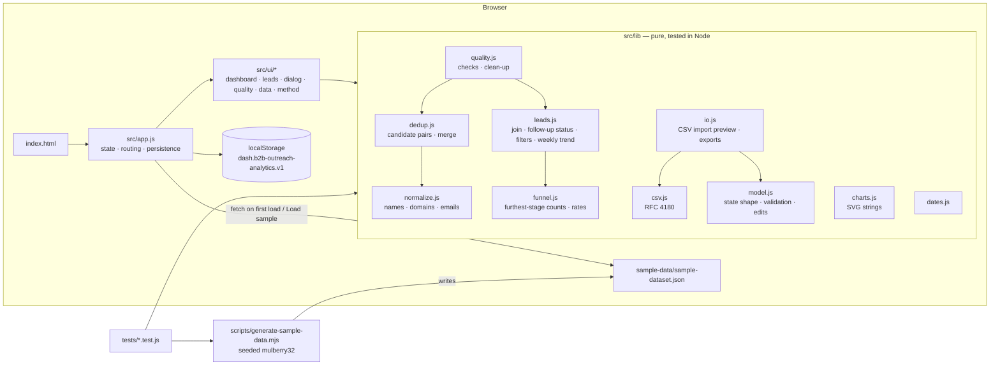

# Architecture

A static single-page app. GitHub Pages serves the repo root as-is: there is no build step, no framework and no dependencies. All business logic is in pure ES modules under `src/lib/`. They never touch the DOM, so the same code runs in the browser and under `node --test`.

## Data flow

1. **State** is one plain object: `organisations`, `contacts`, `opportunities`, `activities`, `dismissedDuplicates`, `settings.today`, `meta` and `log` (see the header of `src/lib/model.js`).
2. **Every change** builds a new state object with a pure function, then calls `ctx.commit(next, message)`:
   - edits: `updateOpportunity`, `addActivity`, `addProspect`
   - merges: `mergeOrganisations`, `mergeContacts`
   - other changes: `cleanState`, `applyProspects`
   
   `ctx.commit` then:
   1. appends to the local change log
   2. saves to `localStorage` (wrapped in try/catch; if storage is unavailable a banner warns the user)
   3. re-renders the current view
   4. announces the change through an `aria-live` region
3. **Derived data** is cached per state object and as-of date by `ctx.derived()`. It holds the quality report plus the joined lead rows. Because nothing is stored pre-computed, every metric updates as soon as the data changes.
4. **Charts** are SVG strings from `charts.js`, sized to their container's measured width. They are redrawn when the window is resized. Each chart has a `<title>`/`<desc>` and a data-table fallback.

## Key decisions

- **Furthest-stage-reached funnel.** Counts come from the current stage, with a Lost lead counting up to `lostFromStage`. This keeps the rates consistent with the editable stage, and you don't need a complete activity history for them to be right. Activities feed the weekly trend and the stage/activity-mismatch check.
- **Never auto-merge or auto-guess.** Duplicate detection only proposes pairs. Cleaning only applies safe, reversible-looking changes, and only after you have seen a preview.
- **Configurable "today".** Overdue logic takes the as-of date as a parameter. That makes it deterministic for the demo and for tests.
- **Import is two-phase.** First `parse*CSV` validates the file and returns valid, warned and rejected rows. Only then does `apply*` change state.
- **Security.** All user text is HTML-escaped before rendering (`esc`). CSV exports guard against formula injection. Restored backups are structurally validated, including referential integrity, before they are accepted. The app makes no third-party requests.
